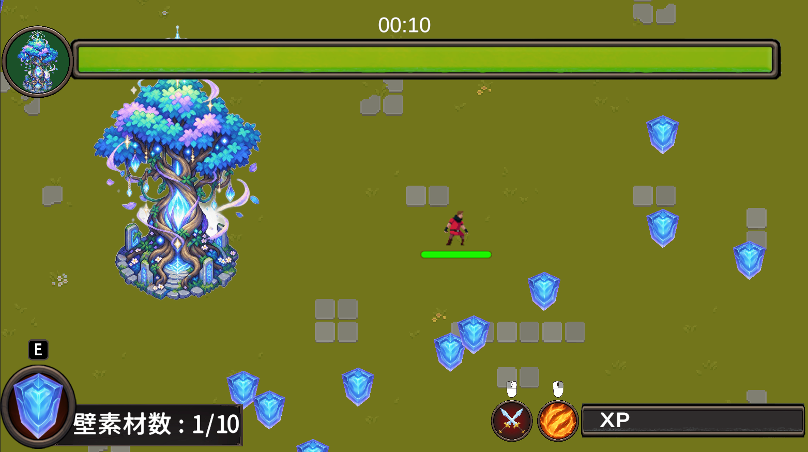
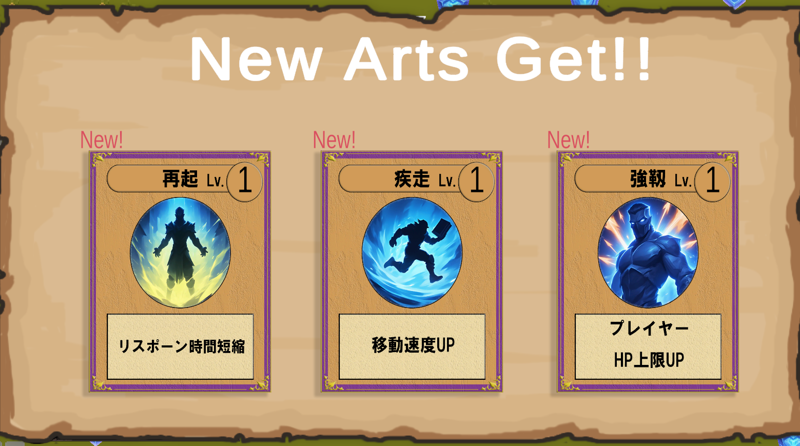

# [魔物の大群が来るので聖樹を守っていたら、落石まで降ってきた件]

## 🎮 概要
[タワーディフェンスローグライク]

- **ジャンル**: ローグライク / タワーディフェンス / バンサバ
- **プレイ人数**: 1人
- **開発環境**: Unity

## 💻 動作環境
- **対応OS**: Windows 11
- **推奨スペック**: メモリ 8GB 以上

## 🕹️ 操作方法
- **[W][A][S][D]**: 移動操作
- **[E]**: 壁の建築
- **[L_Mouse]**: 通常攻撃
- **[R_Mouse]**: スキル使用

## 📷 スクリーンショット
| Screenshot 1 / 画像１ | Screenshot 2 / 画像２ |
| :---: | :---: |
|  |  |
| Screenshot 3 / 画像3 | Screenshot 4 / 画像4 |
|  |  |

## 📜 クレジット・使用素材 / Credits

【アセットに関する注意事項 / Notice Regarding Assets】

本作はポートフォリオ（実績公開）を目的とした非営利作品です。ゲーム内には学生が制作したアセットが含まれています。同梱されている画像・音声などのアセットデータを、本作のプレイ以外の目的で抽出・二次利用、および再配布することを固く禁じます。

This game is a non-commercial portfolio project. It contains assets created by students. Extracting, redistributing, or secondary use of any asset files (images, audio, etc.) included in this game for purposes other than playing is strictly prohibited.
